<div align="center">


# SteamHLTB

**Steam Backlog & Playtime Dashboard with HowLongToBeat Intelligence**

`(⌐■_■)` *Know how long your library takes to beat — including Steam Family Sharing — before you pick what to play next.*

<p>
  <a href="#-live-demos--features"><kbd>(☆ω☆) Features &amp; Demos</kbd></a>&nbsp;&nbsp;
  <a href="#-how-it-works"><kbd>(╭ರ_•́) Architecture</kbd></a>&nbsp;&nbsp;
  <a href="#-installation--setup"><kbd>(ง •̀_•́)ง Quick Start</kbd></a>&nbsp;&nbsp;
  <a href="#-themes--sound-design"><kbd>(ﾉ◕ヮ◕)ﾉ*:･ﾟ✧ 4 Themes</kbd></a>
</p>

</div>

---

> [!NOTE]
> **Adaptive README Preview `( ﾟヮﾟ)`** — The hero screenshot below automatically switches between **Wii Ceramic** (GitHub Light Mode) and **Noir Editorial** (GitHub Dark Mode) using `<picture>` `prefers-color-scheme` media queries.

<p align="center">
  <picture>
    <source media="(prefers-color-scheme: dark)" srcset="docs/media/hero-dark-obsidian.png">
    <source media="(prefers-color-scheme: light)" srcset="docs/media/hero-light-ceramic.png">
    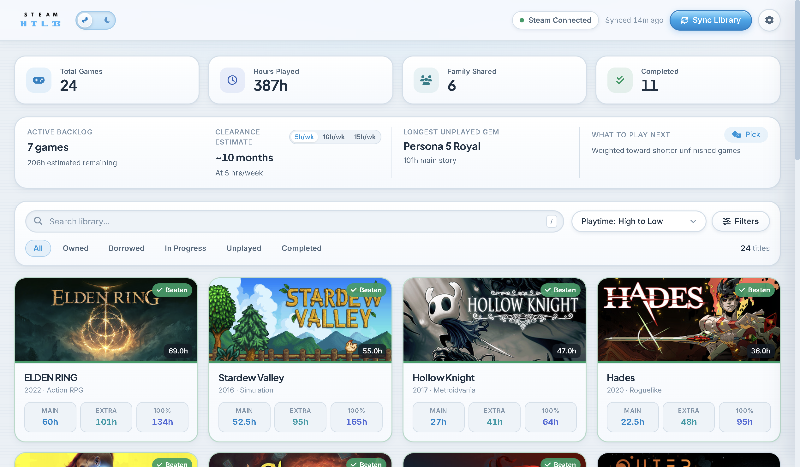
  </picture>
</p>

---

## `(╭ರ_•́)` Why SteamHLTB?

HowLongToBeat is great for looking up one game at a time, and Steam tracks your hours, but neither lets you **slice your entire Steam + Steam Family Sharing library by completion length, remaining backlog hours, and actual playtime** in one local-first workspace.

- **Instant Local-First Library:** Ships with an offline preloaded HLTB catalog (`static/js/preloaded_hltb.json`) and caches your synced Steam library & match overrides in `db.json`.
- **Automatic Steam Family Sharing:** Queries `IFamilyGroupsService/GetSharedLibraryApps` and merges any manual `FAMILY_STEAM_IDS` you configure, tagging borrowed games cleanly with a `Shared` pill.
- **Zero Lock-In / Zero Cloud:** Your Steam API key, SteamID64, and library cache stay 100% on your machine (`config.json` and `db.json`).

---

## `(☆ω☆)` Live Demos & Core Functionalities

### 1. Multi-Layer Filtering, Custom Sorting & Duration Ranges `(☞ﾟ∀ﾟ)☞`

Slice hundreds of games instantaneously without page reloads:
- **Quick Filter Tabs:** `All`, `Owned`, `Borrowed`, `In Progress`, `Unplayed`, and `Completed`.
- **Full HLTB & Playtime Sorting:** Sort by `Playtime` (High to Low / Low to High — placing played titles ascending first and unplayed games cleanly after), `Title` (A–Z / Z–A), **Main Story** (Shortest / Longest), **Main + Extra** (Shortest / Longest), and **100% Completionist** (Shortest / Longest).
- **Advanced Filters Drawer:** Filter by Length Category (`Main Story`, `Main + Extra`, `100% Completionist`), Min/Max hour range, case-normalized **Genre** dropdown, or hide games without HLTB times.

<p align="center">
  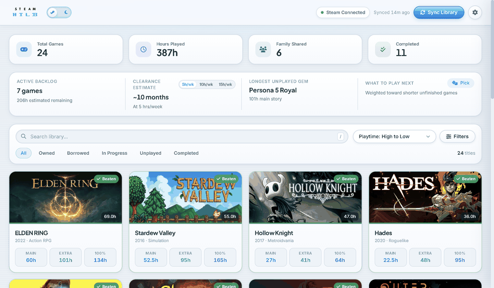
</p>

<details>
<summary><code>(¬‿¬)</code> <strong>Snapshot:</strong> Custom Theme-Native Sort Dropdown &amp; Advanced Filters Drawer</summary>
<br>
<p align="center">
  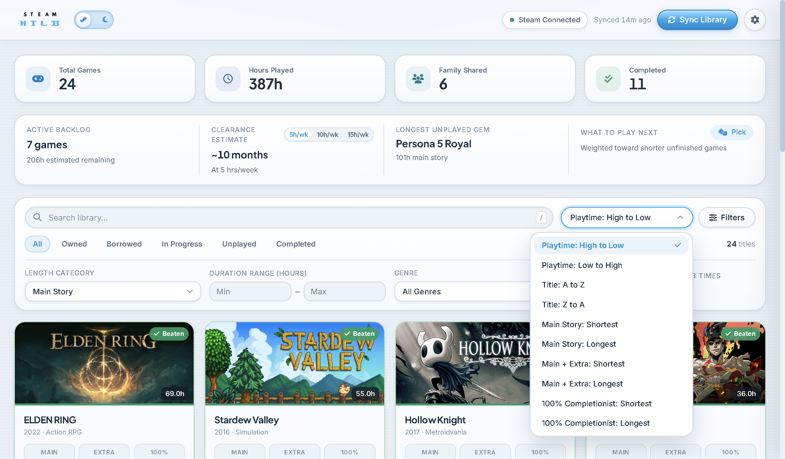
</p>
</details>

---

### 2. Backlog Insights, Clearance Estimator & Game Detail Drawer `( •̀ᴗ•́ )و ̑̑`

Turn raw playtime numbers into actionable backlog decisions:
- **KPI Overview Strip:** Live totals for **Total Games**, **Hours Played**, **Family Shared**, and **Completed**.
- **Active Backlog & Clearance Estimate:** Filters out endless multiplayer/utility titles (`Team Fortress 2`, `Counter-Strike`, `Factorio`, `Civilization`, etc.) to estimate remaining story hours and months/years to clear at **`5h/wk`**, **`10h/wk`**, or **`15h/wk`**.
- **Longest Unplayed Gem & Weighted Dice Picker (`Pick`):** Surfaces your longest untouched game or rolls a weighted pick favoring shorter unfinished titles in your current filtered view.
- **Slide-Over Game Detail Drawer:** Inspect Main / Extra / 100% progress bars, Genres, Developer, Release Year, toggle **Mark as Beaten** manually (persisted in `db.json`), force **Refresh** HLTB data, or **Re-match** if a title matched the wrong edition.

<p align="center">
  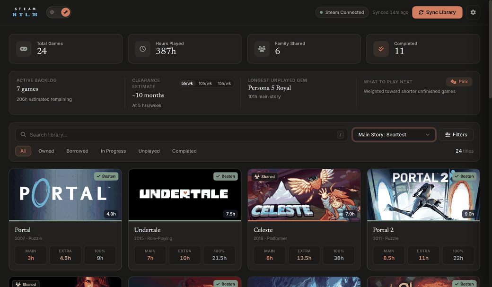
</p>

<details>
<summary><code>( ˘▽˘)っ♨</code> <strong>Snapshot:</strong> Game Detail Slide-Over Drawer (Noir Editorial)</summary>
<br>
<p align="center">
  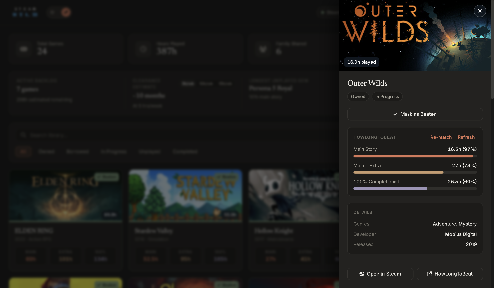
</p>
</details>

---

### 3. Keyboard Shortcuts & Mobile Companion `(づ｡◕‿‿◕｡)づ`

| Shortcut / Input | Action |
| :--- | :--- |
| <kbd>/</kbd> | Focus library search bar from anywhere |
| <kbd>Enter</kbd> / <kbd>Space</kbd> | Open focused game card in Detail Drawer |
| <kbd>↑</kbd> / <kbd>↓</kbd> | Cycle options inside focused Sort or Filter dropdowns |
| <kbd>Esc</kbd> | Close open dropdowns, modals, or Detail Drawer |

<details>
<summary><code>( ﾟヮﾟ)</code> <strong>Mobile / Android Companion:</strong> Touch-first layout with In-Progress progress bars &amp; swipeable filter pills</summary>
<br>
<p align="center">
  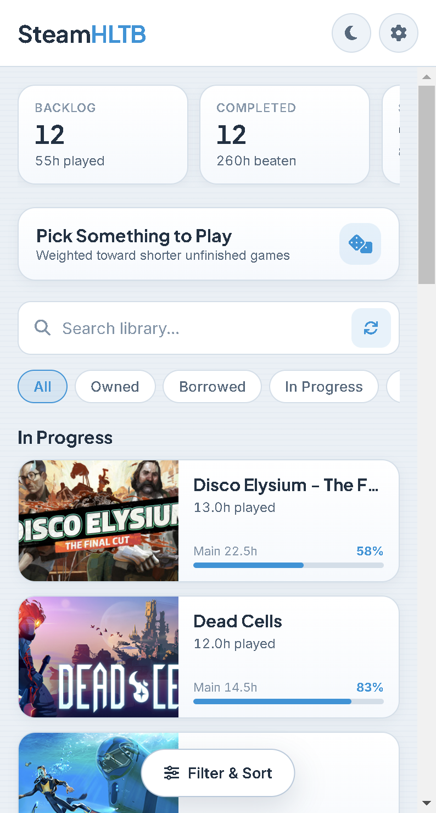
</p>
<p align="center">
  <em>Automatically served on mobile viewports and packaged for Android via Capacitor (<code>capacitor.config.json</code>).</em>
</p>
</details>

---

## `(╭ರ_•́)` How It Works

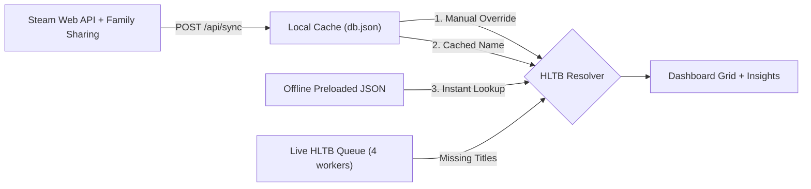

> [!TIP]
> **Quick Sync vs. Force Full Refresh:** Use **Quick Incremental Sync** to pick up newly bought/shared games and updated playtimes without re-querying existing HLTB entries. Use **Force Full Refresh** only if you want to rebuild the local cache from scratch.

<details>
<summary><code>(；一_一)</code> <strong>API Endpoints &amp; Project Layout</strong></summary>

| Method &amp; Route | Purpose |
| :--- | :--- |
| `GET /api/games` | Returns cached library merged with resolved HLTB data &amp; beaten sets |
| `POST /api/sync` | Syncs owned + Steam Family Sharing libraries (`{ force: boolean }`) |
| `GET /api/hltb` | Resolves or force-refreshes HLTB times for a single `title` &amp; `appid` |
| `GET /api/hltb/search` | Searches HowLongToBeat candidates for the manual Re-match modal |
| `POST /api/hltb/rematch` | Saves a per-`appid` HLTB override into `db.json` |
| `POST /api/games/:appid/beat` | Persists manual `beaten` / `unbeaten` overrides |
| `GET` / `POST /api/config` | Reads masked config or saves `STEAM_API_KEY`, `STEAM_ID`, `FAMILY_STEAM_IDS` |

</details>

---

## `(ง •̀_•́)ง` Installation & Setup

### Option A: Standalone Windows Desktop App (Electron) `( ﾟヮﾟ)`

1. Download `SteamHLTB-win32-x64.zip` from **Releases** (or build locally with `npm run build:electron`).
2. Extract and launch **`SteamHLTB.exe`**.
3. Click the **Gear Icon** in the top-right corner to enter your credentials visually — no manual JSON editing required.

---

### Option B: Node.js or Docker `(⌐■_■)`

**Prerequisites:**
1. Obtain a Steam Web API Key at [steamcommunity.com/dev/apikey](https://steamcommunity.com/dev/apikey).
2. Find your 17-digit `SteamID64` (or custom vanity profile name).

Create `config.json` in the project root (or configure it later in the Settings modal):

```json
{
  "STEAM_API_KEY": "YOUR_STEAM_WEB_API_KEY",
  "STEAM_ID": "76561198000000000",
  "FAMILY_STEAM_IDS": ["76561198000000001", "76561198000000002"]
}
```

#### Run with Node.js (v18+ recommended)

```bash
npm install
npm start
# Or launch the Electron desktop wrapper directly:
npm run start:electron
```

#### Run with Docker

```bash
# Create an empty db.json on first run so Docker binds a file (not a directory)
touch db.json            # Windows PowerShell: New-Item db.json -ItemType File
docker-compose up -d
```

Open **`http://localhost:3000`** in your browser `(b ᵔ▽ᵔ)b`.

---

## `(ﾉ◕ヮ◕)ﾉ*:･ﾟ✧` Themes & Sound Design

By default, SteamHLTB runs in **Wii Ceramic** (Light) and **Noir Editorial** (Dark). Inside **Settings**, you can mix and match **any Light skin with any Dark skin** for the header toggle and toggle **Wii U–inspired Web Audio button & hover chimes** tailored to each theme's mood.

<p align="center">
  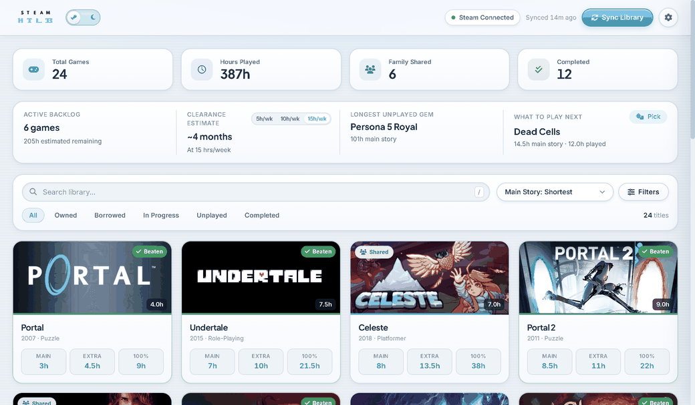
</p>

<details>
<summary><code>(☆ω☆)</code> <strong>Gallery:</strong> Preview All 4 Built-In Skins</summary>
<br>

| Light Mode Skins | Dark Mode Skins |
| :---: | :---: |
| **Wii Ceramic (Default)**<br> | **Noir Editorial (Default)**<br>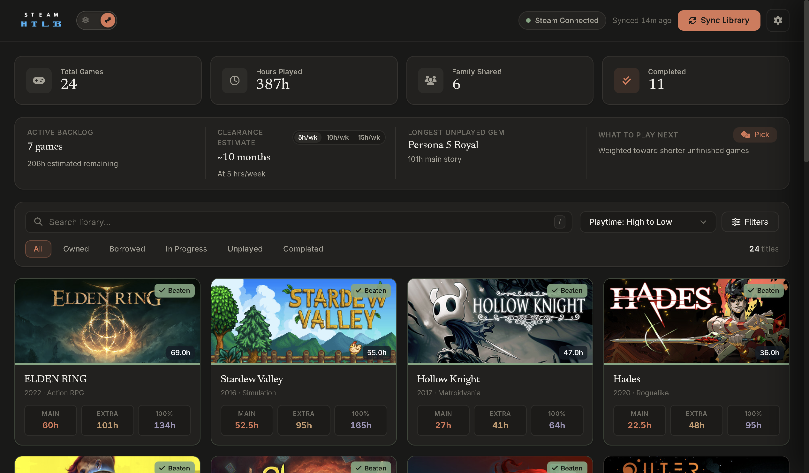 |
| **Crystal Vista (Frutiger Aero)**<br>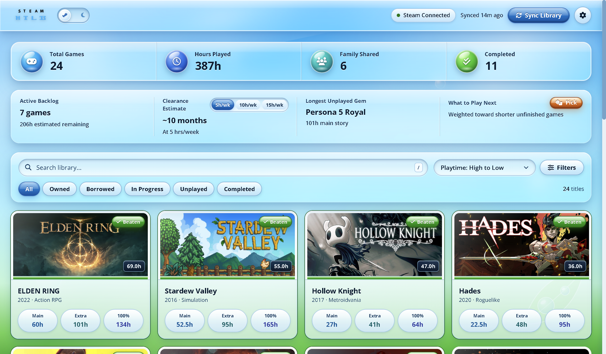 | **Cyber Chrome (Y2K Hardware)**<br>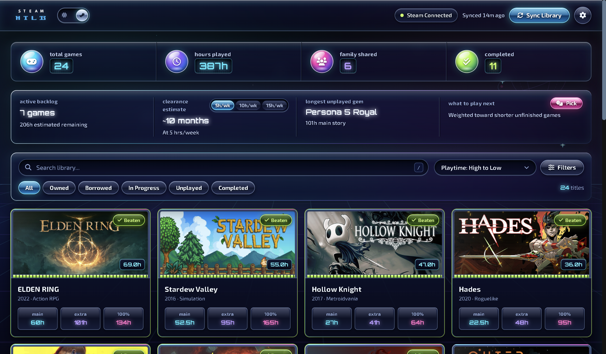 |

</details>

---

## `(ง'̀-'́)ง` Tech Stack & Credits

- **Backend:** Node.js, Express 5, `howlongtobeat`, Electron 31, Capacitor 8
- **Frontend:** Vanilla HTML/JS & CSS Custom Properties (zero frameworks, zero external audio assets — Web Audio synthesis only)
- **Data Sources:** [HowLongToBeat](https://howlongtobeat.com/) & [Steam Web API](https://partner.steamgames.com/doc/webapi_overview)

## `( ﾟヮﾟ)` License

Open Source under the **MIT License**. See [LICENSE](LICENSE) for full details.
